# Sectel — Security Telemetry for Microcontroller IoT Devices

`sectel-mcu-security-telemetry`

> Can a $3 microcontroller tell your security team that it is being attacked, crashed, or impersonated, and can you trust what it says?

Sectel is a research project and reference implementation that answers this question on real hardware. A tiny agent inside ESP32 firmware records security-relevant events, delivers them reliably over mutually authenticated TLS, and an open-source SIEM pipeline (Elastic) turns them into detections that an analyst can investigate.

**Status:** MVP in progress (late October 2026). The end-to-end pipeline runs on an ESP32-C3 with mutual TLS; four scenarios (boot loop, Wi-Fi outage, mTLS/ACL, rogue broker) have been executed and measured. See [Roadmap](#roadmap) for what is coming next.

---

## Table of contents

- [The problem](#the-problem)
- [What Sectel does](#what-sectel-does)
- [What Sectel is not](#what-sectel-is-not)
- [Architecture](#architecture)
- [Telemetry: format and events](#telemetry-format-and-events)
- [Detections](#detections)
- [Results so far](#results-so-far)
- [Footprint](#footprint)
- [Security model](#security-model)
- [Known limitations](#known-limitations)
- [Repository layout](#repository-layout)
- [Quick start](#quick-start)
- [Roadmap](#roadmap)
- [How this relates to existing tools](#how-this-relates-to-existing-tools)
- [Research context](#research-context)
- [License and disclaimer](#license-and-disclaimer)

---

## The problem

Most connected products are not Linux boxes. They are microcontrollers (ESP32, nRF, STM32) running an RTOS with a few hundred kilobytes of RAM and no memory protection. To a security team, these devices are close to invisible:

- **There is nowhere to put a security agent.** Endpoint agents, audit daemons and process-level logging assume an operating system the device does not have.
- **The evidence that exists is thin and scattered.** Security-relevant activity may surface only as a reset reason, a failed connection, or an update status, often in ad-hoc debug logs.
- **Even good events are hard to investigate.** Missing sequence numbers, unreliable clocks, unstable identifiers and unclear origin make it difficult to correlate events or to know whether they can be trusted.
- **The network is part of the attack surface.** A device reporting over Wi-Fi can be disconnected, redirected to a rogue access point, or pointed at a fake server, which also affects whether its evidence arrives at all.

At the same time, regulation is catching up. The EU Cyber Resilience Act expects products with digital elements to record and monitor security-relevant internal activity, with manufacturer reporting obligations applying from September 2026 and full obligations from December 2027.

The question this project tests is not whether a microcontroller can send logs (it can), but **whether the evidence it produces is good enough to detect and investigate real attack scenarios**, and where it falls short.

## What Sectel does

| | |
|---|---|
| 🧩 **Embeds as one component** | A self-contained ESP-IDF component (`sectel`) that records security events with ~4 KB of flash and ~8 KB of RAM. |
| 🧾 **Produces structured evidence** | A compact binary format with sequence numbers, a persistent boot counter, device time with a sync flag, and explicit overflow signalling. |
| 📦 **Delivers reliably** | Store-and-forward queue on the device, MQTT QoS 1 with broker acknowledgement, persistent sessions on the server side. Loss and duplicates are detected, not hidden. |
| 🔐 **Knows who is talking** | Mutual TLS with a certificate per device; the broker only accepts events on a topic that matches the device certificate. |
| 🚨 **Turns events into detections** | Rules in Elastic (ES&#124;QL) with a portable Sigma representation, each tied to a reproducible attack scenario. |
| 🔎 **Keeps investigation context** | Reset reasons, firmware hash, access point, delivery lag and provenance travel with every event. |
| 📏 **Measures itself** | Every scenario records detection time, delivery reliability and resource cost on the device. |

## What Sectel is not

- **Not firmware hardening.** Secure boot and flash encryption protect the firmware; Sectel *reports* whether they are enabled but does not implement them.
- **Not a general-purpose SIEM** or a claim of comprehensive IoT attack detection. The scope is a selected set of scenarios, tested honestly.
- **Not a compliance certificate.** It can support evidence and monitoring practices for frameworks such as the CRA or IEC 62443; a mapping is not conformity.

---

## Architecture

```mermaid
flowchart LR
    subgraph Device["ESP32-C3 (FreeRTOS / ESP-IDF)"]
        A["Event sources<br/>boot · heartbeat · wifi · tls_error"] --> B["Envelope<br/>seq · boot_count · time"]
        B --> C[("RAM queue<br/>32 frames")]
        C --> D["MQTT client<br/>mTLS · QoS 1"]
    end
    D -- "TLS 1.2, client cert" --> E["Mosquitto broker<br/>ACL by cert CN<br/>persistent sessions"]
    E --> F["Python collector<br/>decode · validate<br/>received_at · seq_gap"]
    F --> G["events.jsonl"]
    G --> H["Logstash<br/>normalize · idempotent IDs"]
    H --> I[("Elasticsearch")]
    I --> J["Kibana<br/>Discover · ES&#124;QL rules"]
```



**Key design decisions**

| Decision | Why |
|---|---|
| Binary format on the device, JSON only on the server | About 10× smaller per event: less radio time and RAM on the device. |
| Severity assigned in the SIEM, not on the device | The device reports facts; policy can change without a firmware update. |
| Device ID is not inside the frame | Identity comes from the transport (client certificate + broker ACL), not from what the device claims. |
| Frame leaves the queue only after broker PUBACK | Store-and-forward survives network outages. |
| Server receive time is the primary timeline | Device clocks are untrusted; device time is kept separately with a sync flag and a measured lag. |
| Fail-open agent | A telemetry failure must never take down the product. |
| Idempotent ingestion | Re-reading the event file cannot create duplicate documents in Elasticsearch. |

---

## Telemetry: format and events

Every frame starts with the same 21-byte header (little-endian):

| Bytes | Field | Purpose |
|---|---|---|
| 0–1 | `magic` (`ST`) | Frame identification |
| 2 | `schema_version` | Currently `2` |
| 3 | `event_type` | Append-only event registry |
| 4–5 | `payload_len` | Length validation |
| 6 | `flags` | `time_synced`, `buffer_overflow` |
| 7–8 | `boot_count` | Persistent in NVS: boot loops and loss across reboots |
| 9–12 | `seq` | Per-boot sequence: gaps and duplicates |
| 13–16 | `uptime_ms` | Monotonic device time |
| 17–20 | `ts` | Unix time, `0` until SNTP sync |

| Type | Event | Key fields | Status |
|---|---|---|---|
| 1 | `boot` | reset reason, secure boot / flash encryption state, previous session uptime, firmware hash and version | ✅ |
| 2 | `heartbeat` | queue depth, dropped frames, free / minimum heap | ✅ |
| 3 | `wifi` | connected / disconnected, reason, BSSID, RSSI, channel, auth mode, aggregated disconnect count | ✅ |
| 4 | `tls_error` | category (cert_verify / handshake / mqtt_refused), esp-tls and mbedTLS codes, X.509 flags, aggregated failure count | ✅ |
| 5 | `ota` | update stage, signature result, target version | 🔜 next |

The collector adds server-side context to every event: `received_at`, `device_id` with its source (`mtls_acl` when enforced by the broker), `seq_gap`, `duplicate`, `device_time` and `lag_ms`.

---

## Detections

Detection logic is written twice on purpose:

- **Native ES&#124;QL** (`detections/native/`) is what actually runs in Kibana and is tested against the scenarios.
- **Sigma** (`detections/sigma/`) is the portable, vendor-neutral description of the same logic, so the rules can be reviewed, shared, and converted for other SIEMs.

Sigma is only claimed where a conversion path has been tested. Until then, the native query is the documented execution path.

| Rule | Logic | ES&#124;QL | Sigma | Tested |
|---|---|---|---|---|
| Boot loop | ≥ 3 boots per device in 5 min, with reset reasons | ✅ | ✅ written (correlation rule), conversion not yet tested | ✅ S1 |
| Wi-Fi disconnect flood | ≥ 5 disconnects per device in 5 min | ✅ | 🔜 | ✅ S2 |
| Wi-Fi BSSID change | Device joined more than one access point in 24 h (possible evil twin) | ✅ | 🔜 | ⏳ S3 |
| Wi-Fi open network | Device joined an open / WEP network | ✅ | 🔜 | ⏳ S3 |
| TLS / rogue broker | Any TLS failure towards the fixed broker in 15 min (cert rejected, handshake failure) | ✅ | ✅ written (cert failure, downgrade), conversion not yet tested | ✅ S4 (variant A) |
| OTA tampering / downgrade | Unsigned or older image rejected | 🔜 | 🔜 | 🔜 S5 |
| Insecure device posture | Secure boot or flash encryption disabled in the field | 🔜 | 🔜 | 🔜 S6 |

Mapped where a technique genuinely applies: boot loop → MITRE ATT&CK for ICS **T0816 (Device Restart/Shutdown)**, rogue broker → **T0830 (Adversary-in-the-Middle)**.

---

## Results so far

All measurements below are from the lab bench (one ESP32-C3, home Wi-Fi, local Elastic stack). Details and raw observations are in `scenarios/`.

### Scenarios

| Scenario | What we did | Outcome |
|---|---|---|
| **S1 Boot loop** (software restart) | `esp_restart()` every 20 s | Detected about 1 min after the 3rd boot. Some boots were lost before delivery, which made the alert flap and exposed a real limitation (see below). |
| **S1 Crash loop** | `abort()` every 20 s | Detected; `reset_reason = panic` distinguishes a crash from a planned restart; 5 of 5 boots received in sequence. |
| **S2 Wi-Fi outage / disconnect flood** | Access point unplugged for ~2 min | Detected 51 s after the device reconnected. ~64 reconnect attempts were reported in just 13 frames thanks to rate limiting, so older evidence was not evicted. |
| **mTLS and ACL** (scenarios/03_mtls) | Valid device, spoofed topic, foreign certificate, no certificate | Own topic accepted; publishing to another device's topic denied; client without certificate rejected during the TLS handshake. |
| **S4 Rogue broker** (variant A) | Fake broker on the real address with a certificate from an untrusted CA | Every connection attempt rejected during the handshake by both the device and the collector; the fake broker received nothing. `tls_error` (`cert_verify`) delivered after the real broker returned; alert raised. Variants B (wrong address) and C (plaintext downgrade) are prepared. |

### Delivery reliability (a finding worth sharing)

Stopping the broker for one minute first **lost 13 frames, then 8**, even though the device had received an acknowledgement for each of them. The reason: a broker PUBACK proves that the *broker* got the frame, not that the SIEM did. While the collector was reconnecting, the broker dropped messages for it.

The loss was caught only because every frame carries a sequence number (`seq_gap = 13`). After enabling persistent broker storage and a persistent collector session, a ~79 s outage lost **0 frames**, and `lag_ms` showed exactly how long each event had waited (74.5 s → 4.5 s, in 10 s steps).

> Reliable delivery needs all three hops configured consistently: the device, the broker and the consumer. Sequence numbers are what make silent loss visible.

### What the device can and cannot tell (another finding)

On ESP-IDF v6, esp-tls reports the mbedTLS error as a positive value and does not propagate the X.509 verification flags. The first rogue-broker run was therefore classified as a generic handshake failure; the fix recognises `-0x2700` (certificate verification failed) directly.

The consequence is more interesting than the bug: the device knows **that** the broker certificate was rejected, but not **why**. An untrusted CA and a certificate for the wrong address look identical on the device. Telling them apart requires a second source of evidence, such as the broker side or the network.

### Timing

| Metric | Value |
|---|---|
| SNTP sync after Wi-Fi IP | ~0.4 s (~2.2 s after boot) |
| First event delivered after boot, plain MQTT | ~4.5 s (down from ~11.4 s after tuning the reconnect timeout) |
| First event delivered after boot, mTLS | ~6.3 s (+1.8 s for the ECDSA handshake) |
| Normal delivery lag | below the 1 s resolution of device time |

---

## Footprint

Measured on ESP32-C3 with `idf.py size-components`.

| Item | Flash | RAM |
|---|---|---|
| **Sectel agent (`libsectel`)** | **3.7 KB** (before `tls_error`; re-measure pending) | **~8 KB** (5 KB static, mostly the queue, + 3 KB task stack) |
| MQTT client stack, if not already in the product | ~38 KB | ~10 KB at runtime |
| Enabling mTLS | ~0 KB (TLS libraries already linked) | ~30 KB at runtime |
| **Whole firmware image** | **~945 KB** of a 1.875 MB OTA slot (~50%) | 109 KB of 321 KB static DRAM |
| Free heap at runtime | — | ~183 KB |

The agent is roughly **0.2% of the firmware slot and 2.5% of RAM**. Repeated TLS handshakes during the rogue-broker attack did not exhaust memory (minimum free heap ~171.5 KB). Nearly all of the image is the Wi-Fi and networking stack that a connected device needs anyway.

---

## Security model

- **Transport:** MQTT over TLS 1.2 (ECDHE-ECDSA-AES256-GCM-SHA384) with a per-device client certificate (ECDSA P-256).
- **Identity and provenance:** the broker uses the certificate CN as the username and an ACL allows each device to publish only to `sectel/<CN>/ev`. Events are marked `device_id_source: mtls_acl`.
- **Integrity of evidence:** sequence numbers, persistent boot counter, overflow flag and dropped-frame counters make loss and replay measurable.
- **Time:** server receive time is authoritative; device time is accepted only with a sync flag and checked through `lag_ms`.
- **Broker authenticity:** the device and the collector both verify the broker certificate against the project CA; a broker with any other certificate is refused and the refusal is reported as `tls_error`.

What this does **not** protect against yet: a fully compromised device can still lie about its own state, and the device private key is stored unencrypted in flash (see limitations).

---

## Known limitations

These are results, not footnotes. Each one was observed on the bench.

1. **A device reports attacks on its network through that same network.** Evidence of Wi-Fi attacks arrives only after the device reconnects.
2. **Restarting faster than the first delivery makes a boot loop invisible.** Events queued in RAM are lost on every restart.
3. **Loss at the end of a boot is not visible as a sequence gap,** because `seq` restarts at 0; it is measurable only through gaps in `boot_count`.
4. **A physical reset looks like a power-on.**
5. **Forged deauthentication frames are accepted** because Protected Management Frames were not in use (`pmf:0`).
6. **A denied publish is silent to the device** under MQTT 3.1.1; the attempt is visible only in the broker log.
7. **The device private key is stored in plaintext flash.** Without flash encryption a stolen device could be cloned.
8. **Device time has 1 s resolution,** so sub-second lag is noise.
9. **The device cannot tell why a broker certificate was rejected** (untrusted CA vs wrong address) on ESP-IDF v6.
10. **A rogue broker can block telemetry,** even though it cannot read it: during the attack the SIEM sees silence.
11. **One board, one network, lab conditions.** Results are not yet validated on other hardware or at fleet scale.

---

## Repository layout

```
iot-security-platform/
├── firmware/esp32-security-telemetry/   ESP-IDF project
│   ├── components/sectel/               the agent (core, events, wire format)
│   └── main/                            Wi-Fi, configuration, test scenarios, certs/
├── backend/                             decoder, collector, tests, Mosquitto config + ACL
├── pki/                                 test CA and certificate script (keys are git-ignored)
├── pipeline/                            Docker Compose: Elasticsearch, Logstash, Kibana
├── detections/
│   ├── native/                          ES|QL rules (executed)
│   └── sigma/                           Sigma rules (portable)
├── scenarios/                           method, results and limitations per scenario
│   ├── 01_boot_loop/
│   ├── 02_wifi/
│   ├── 03_mtls/
│   └── 04_tls_mitm/                     rogue broker configs and certificate script
└── eval/                                size and evaluation data
```

---

## Quick start

> Tested on macOS (Apple M1) with ESP-IDF v6.0.1, Mosquitto 2.1, Python 3.11, Elastic 8.18 in Docker (OrbStack). You need an ESP32-C3 board and a 2.4 GHz Wi-Fi network.

**1. Certificates**
```bash
cd pki
bash make_pki.sh <broker_ip> esp32-<device_wifi_mac>
cp ca.crt device.crt device.key ../firmware/esp32-security-telemetry/main/certs/
```
The second argument must match the device MQTT client ID (`esp32-` + Wi-Fi MAC), because the broker uses the certificate CN for access control.

**2. SIEM stack**
```bash
cd pipeline
echo "ELASTIC_VERSION=8.18.0" > .env
echo "KIBANA_ENCRYPTION_KEY=$(openssl rand -hex 32)" >> .env
docker compose up -d
```

**3. Broker and collector**
```bash
cd backend
mkdir -p mosquitto-data
mosquitto -c mosquitto.conf -v          # terminal 1
pip3 install -r requirements.txt
python3 -m pytest -q tests
python3 collector.py                    # terminal 2
```

**4. Firmware** (`sdkconfig.defaults` sets the target, 4 MB flash and the partition table)
```bash
cd firmware/esp32-security-telemetry
idf.py set-target esp32c3
idf.py menuconfig      # Sectel demo config: Wi-Fi, broker URI mqtts://<broker_ip>:8883, NTP server
idf.py build flash monitor
```

**5. Kibana** at http://localhost:5601: create a data view `sectel-events-*` (time field `@timestamp`), then add the rules from `detections/native/` under Stack Management → Rules → Elasticsearch query (ES|QL).

---

## Roadmap

### Next (to complete the MVP)

- [x] ~~`tls_error` event + rogue broker scenario (S4), variant A~~
- [ ] **S4 variants B and C:** certificate for the wrong address; plaintext downgrade.
- [ ] **Device posture rule (S6):** flag devices running without secure boot or flash encryption.
- [ ] **`ota` event + signed updates (S5):** unsigned or downgraded images are rejected and reported.
- [ ] **Evil twin scenario (S3):** rogue access point with the same SSID and password.
- [ ] **"Device silent" rule:** missing heartbeats as a signal of blocking or outage.
- [ ] **Sigma for every rule** and a tested conversion path with pySigma; where a rule cannot be converted, the reason is documented.
- [ ] **OCSF mapping** of every event and field, so the data fits standard security tooling.
- [ ] **Schema specification** (`schema/sectel-v2.md`) with versioning rules.
- [ ] **Elastic Security detection engine:** move rules from Stack Management to Security for MITRE mapping, alert triage and timelines (requires enabling Elasticsearch security).
- [ ] **Consolidated evaluation:** detection, delivery, timing and overhead tables, plus false-positive notes.

### Later

- [ ] Independent network observations (Zeek) and broker logs as a second evidence source, e.g. to tell why a TLS connection failed.
- [ ] MQTT 5 so the device can see and report rejected publishes.
- [ ] Persistent event buffering (RTC memory or flash) to survive restarts.
- [ ] TLS 1.3 on the device; millisecond timestamps.
- [ ] A second board with secure boot and flash encryption enabled, side by side with an unprotected one.
- [ ] Deauthentication testing on own equipment, with and without PMF.
- [ ] Correlating firmware hashes with SBOM / CVE data: which devices in the field run a vulnerable build.
- [ ] Ports beyond ESP32.

---

## How this relates to existing tools

| Tool | Focus | Relation |
|---|---|---|
| Memfault (Nordic) | Device observability for MCUs: crashes, reboots, metrics, OTA | Overlaps on raw signals; built for reliability engineering. Sectel targets security operations: provenance, evidence integrity, attack-oriented events, detections in the defender's own SIEM. |
| Exein Runtime / Analyzer | Runtime protection for embedded Linux; firmware scanning, SBOM and CVEs | Complementary: Analyzer tells you what is in the firmware; Sectel shows what happens to devices in the field. |
| SandGrain | Hardware-based device identity | Complementary: who the device is vs what is happening to it. |
| AWS IoT Device Defender | Device metrics and anomaly detection inside AWS | Vendor-bound; Sectel is SIEM-neutral and open. |

Descriptions reflect public material as of October 2026.

---

## Research context

This repository is the implementation part of a technical investigation:

> **Can a low-cost ESP32-based device generate sufficient structured security telemetry to support practical detection and investigation of selected embedded-device attack scenarios through an open-source SIEM pipeline?**

The project tests the practical limits of security telemetry from a constrained device. It focuses on the quality, reliability and investigative value of evidence that can realistically be collected, and it documents where device-side telemetry is not enough. Standards used as references: OCSF, MITRE EMB3D, MITRE ATT&CK (Enterprise / ICS), Sigma, EU CRA, IEC 62443, NIST CSF, ISO 27001.

Feedback from embedded, product security and SOC practitioners is very welcome. Open an issue or reach out directly.

---

## License and disclaimer

See [LICENSE](LICENSE).

This is research and lab software, not a production security product. The test PKI, disabled Elasticsearch security and local setup are for experimentation only. Run Wi-Fi attack scenarios (deauthentication, rogue access points) **only against equipment you own**; interfering with third-party networks is illegal in most jurisdictions.

**Author:** Aydin Berkman
